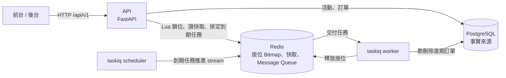

# 售票系統 Backend

演唱會售票系統的後端 API，**可支援萬人級別的大型場地**。

管理員建立場地與活動，顧客選位下單；付款期限內保留座位，逾期未付款就自動釋放回票池。

## 技術 Stack

- **FastAPI**：API 服務
- **PostgreSQL**：主資料庫（事實來源）
- **Redis**：座位鎖定、快取、Message Queue
- **taskiq Worker**：Message Queue 的 Consumer，負責釋放逾期未付款的訂單

其他：Python 3.14、SQLModel / Pydantic、Alembic、dependency-injector、uv、pytest

## 關鍵技術與架構決策

| 要解決的問題 | 技術方案 | 說明 |
| --- | --- | --- |
| **防止超賣** | Redis + Lua 原子操作（Atomicity） | 座位預訂邏輯封裝在 Lua 腳本<br>多個座位一次檢查、一次鎖定，高併發下不會重複賣出 |
| **記憶體優化** | Redis Bitmap 座位表 | 每個座位只用 1 個 bit：0 = 可售、1 = 已售<br>依區域（Zone）切分；一萬個座位約 1.25 KB |
| **高流量讀取** | Redis 快取 + Stale-While-Revalidate（SWR） | 過期時先回舊資料，背景只放一個請求回源更新<br>避免快取擊穿（Cache Breakdown）壓垮資料庫 |
| **逾期訂單釋放** | Delayed Queue + Message Queue（Redis Streams） | 付款期限一到，自動釋放座位<br>任務在確認（ack）前不會遺失 |
| **資料一致性** | PostgreSQL 為唯一事實來源（Single Source of Truth） | Redis 資料皆可從資料庫重建 |

## 系統架構



## 功能

**後台（管理員）**
- 建立場地、區域與座位表
- 建立活動、設定各區票價，並上架或下架

**前台（顧客）**
- 瀏覽已上架的活動與即時座位狀態
- 一次訂購同一場活動的多個座位
- 下單後在付款期限內保留座位，逾期未付款就自動釋放

## 快速開始

需要 [uv](https://docs.astral.sh/uv/)（會依 `.python-version` 自動安裝 Python 3.14）與 Docker Compose。

```bash
# 1. 安裝依賴（含 dev group）
uv sync

# 2. 建立環境變數檔，並把產生的字串填進 JWT_SECRET_KEY（必填，否則 API 無法啟動）
cp .env.example .env
python -c "import secrets; print(secrets.token_urlsafe(48))"

# 3. 啟動 Postgres（:15432）與 Redis（:16379），並建立資料表
docker compose up -d
uv run alembic upgrade head

# 4. 啟動 API
uv run uvicorn main:app --reload

# 5. 另開兩個 terminal 啟動背景工作，沒開的話逾期訂單不會被釋放
uv run taskiq worker app.workers.main:broker app.queue.delayed.process_expired_order
uv run taskiq scheduler app.workers:scheduler app.queue.delayed.process_expired_order

# 6. 建立第一個 ADMIN（會提示輸入密碼，至少 8 個字元）
uv run python -m app.scripts.create_admin --name Root --email root@example.com
```

啟動後開 <http://localhost:8000/docs> 看 Swagger 文件。設定由 `app/config.py` 讀取，預設讀 `.env`，設 `ENV_FILE` 可以換成別的檔案。

## API

完整路由以 Swagger 為準。所有 API 都在 `/api/v1` 底下：

- **前台**：顧客以 Google 登入；瀏覽活動不需登入，下單與付款需要。
- **後台**：路徑以 `/admin` 開頭，manager 以 email 與密碼登入（`POST /api/v1/admin/auth/login`）；管理 manager 帳號限 ADMIN。
- ADMIN 帳號只能從 CLI 建立；API 只讓 ADMIN 新增 MANAGER（`POST /api/v1/admin/managers`）。

## 專案結構

```
main.py              Uvicorn 入口（re-export app.main:app）
app/
  main.py            FastAPI app
  config.py          環境變數設定
  containers.py      依賴注入容器
  routers/           HTTP 路由（auth / manager / venue / event / order），各分前台與後台
  services/          業務流程；validators/ 放業務規則檢查
  aggregates/        領域聚合（event、order）
  repositories/      Postgres 存取
  models/            SQLModel 資料表
  schemas/           API 與內部用的 Pydantic schema
  cache/             Redis 存取；lua/ 放原子操作腳本
  libs/security/     密碼雜湊、access token、Google ID token 驗證
  libs/payment.py    金流介面（PaymentGateway）與開發用的假金流
  scripts/           CLI 工具（create_admin）
  workers/           taskiq broker 與 worker 入口
  queue/delayed/     延遲任務（付款期限到期）
migrations/          Alembic migration
tests/unit/          單元測試（fake 取代外部依賴）
tests/e2e/           走真實 Postgres / Redis 的測試
```

## 開發

### 測試

e2e 測試每一題都會 `TRUNCATE` 所有資料表並清空 Redis，所以用的是獨立的測試環境
（`docker-compose.test.yaml`，Postgres :55432、Redis :56379），不會碰到開發資料。
`tests/conftest.py` 會檢查設定，指向的不是測試環境就拒絕執行。

```bash
# 啟動測試用的 Postgres / Redis（--env-file 不能省，否則會用到開發用的資料庫名稱）
docker compose --env-file .env.test -f docker-compose.test.yaml up -d

# 建立測試資料庫的資料表
ENV_FILE=.env.test uv run alembic upgrade head

# 跑全部測試（pytest 會自動改讀 .env.test）
uv run pytest

# 只跑單元測試或 e2e
uv run pytest tests/unit
uv run pytest tests/e2e
```

測試環境的資料不需要保留，壞掉就 `docker compose -f docker-compose.test.yaml down -v` 再重建。

### 資料庫 Migration

```bash
uv run alembic upgrade head                            # 升到最新
uv run alembic downgrade -1                            # 退一版
uv run alembic revision --autogenerate -m "說明"        # 依 model 變更產生新版本
```

Migration 檔在 `migrations/versions/`。

## 下一階段

- 高併發情境下的限流機制
- 以 CDN 快取靜態活動資訊，與 Redis 形成分層快取
- 活動搜尋功能
